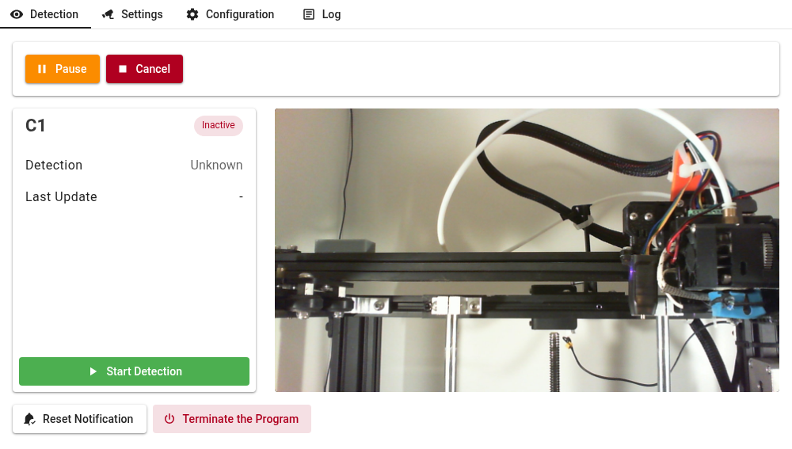
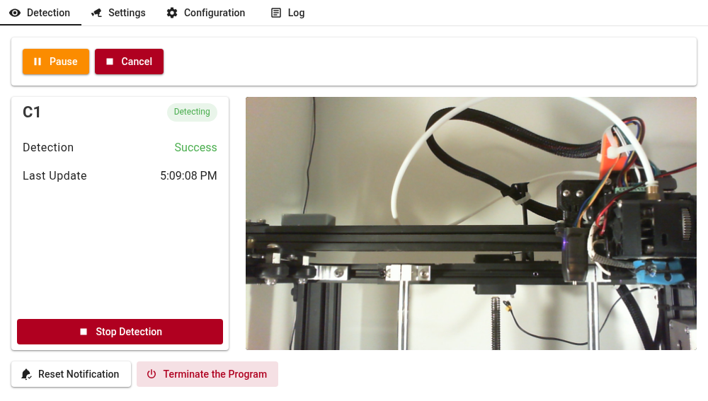
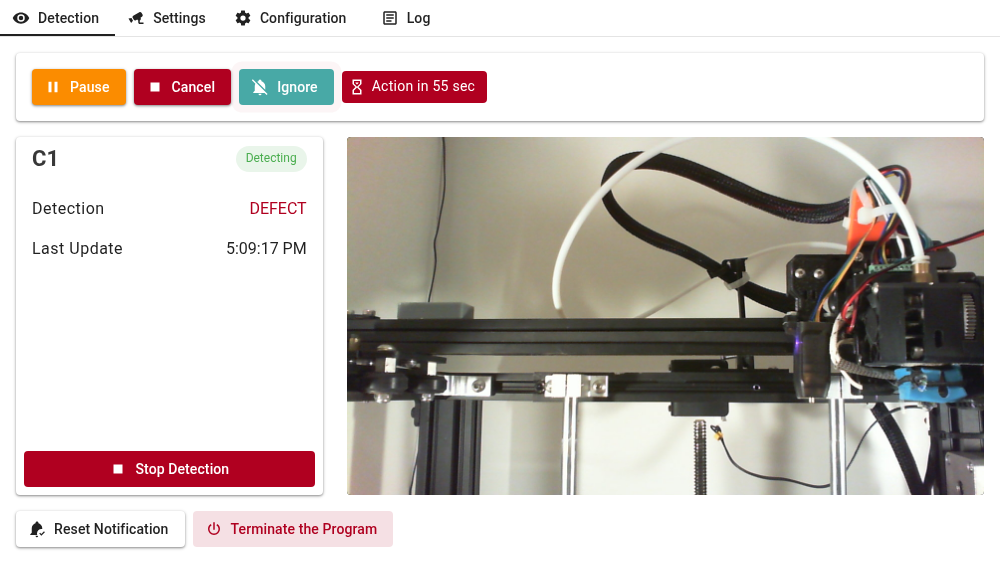
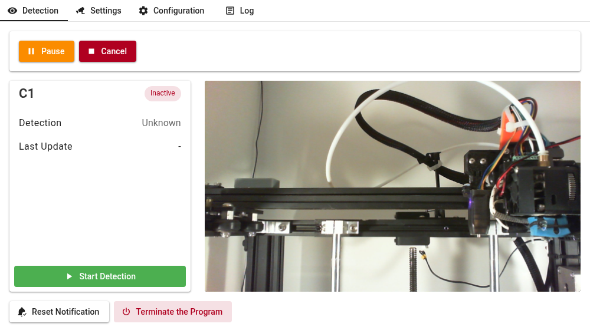
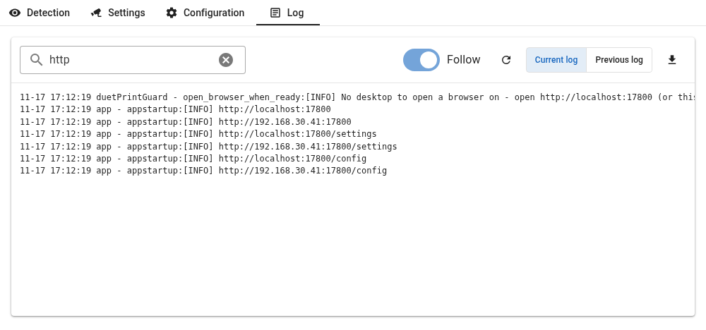

# duetPrintGuard - Basic Operation

The main page is accessible via `http://localhost:<PORT>` or `http://<IP>:<PORT>`  This is the page displayed in DWC when running as the plugin. With a standalone board, use this address directly (see [Standalone boards](Installation-Configuration.md#standalone-boards)).

IP and PORT are those in use by the plugin. They are shown on the Configuration page and in the log file at startup.

The tabs at the top of each page switch between the four pages:
- Detection - the main page, described here
- Settings - cameras and the defect countdown (see [Installation-Configuration](Installation-Configuration.md#camera-setup))
- Configuration - the printer connection, printer commands, notifications and the web interface (see [Installation-Configuration](Installation-Configuration.md#configuration-page))
- Log - the log file (see [Log page](#log-page))

While the printer is not connected, every page shows a banner at the top saying why, and whether duetPrintGuard is still trying. It has fields for the printer's address, port and password, and a `Save and connect` button.

Broadly, there are three main states
- Not Detecting
- Detecting - No Defect
- Detecting - Defect

### Not Detecting

This image shows the Detection page comprising three sections.
- top control section
- middle camera section
- bottom control section

 

The top control section provides printer control (`Pause` / `Resume` and `Cancel`) and displays countdown information. Each button asks for confirmation before it is sent to the printer.

In the middle section: each configured camera is shown separately with the following details:
 - The Camera nickname
 - Current detection status [Inactive]
 - Current detection result [Unknown]
 - The time of the last update [-]
 - A snapshot of the camera's view, taken when the page was opened
 - A button to toggle Detecting on and off [Start Detection]

 Note that clicking on a camera view will open its live stream in a new browser tab. HTTP cameras are shown there directly from the camera, at the camera's own frame rate. RTSP cameras (which browsers cannot play directly) are shown through the plugin at up to 10 frames per second.

 To keep the number of connections to the plugin low, the Detection page closes its camera streams and stops updating while it is not shown (e.g. another browser tab or another DWC page is shown, or a camera stream has been opened in a new tab). It reconnects, and takes new snapshots, when it is shown again. The Settings page and the camera stream tab do the same. Detection carries on in the background regardless - closing or hiding a page never stops detection.

 ### Detecting - No Defect

 Once a camera is detecting the display is updated regularly with:

 - Current detection status [Detecting]
 - Current detection result [success, failure]
 - The time of the last update [time]
 - The live camera stream, in place of the snapshot (up to 10 frames per second)
 - A button to toggle Detecting on and off [Stop Detection]

 
 
### Detecting - Defect

If a failure occurs several things happen:

On the top control section:
 - An `Ignore` button is added
 - A countdown is shown, labelled with the configured `Countdown Action` (`Pause in .. sec`, `Cancel in .. sec`, or `Action in .. sec` when the action is Ignore)
 - The button for the configured `Countdown Action` flashes

The camera information is updated
 - Current detection status [Detecting]
 - Current detection result [DEFECT]
 - The time of the last update [time]
 - A button to toggle Detecting on and off [Stop Detection]

All cameras keep detecting during the countdown, so any other camera that also sees the failure shows DEFECT too. Only one countdown runs at a time - a new one can start once the current one has been dealt with.

Pressing `Pause`, `Cancel` or `Ignore` during the countdown stops the countdown and takes that action immediately. `Ignore` dismisses the defect so that a new one can be raised.

If the user does nothing within the configured `Countdown Time` - the `Countdown Action` will be sent to the printer as follows:

- Ignore - does nothing
- Pause - pauses the printer, stops detection (the cameras show `Paused`), and changes the `Pause` button to `Resume`. Resuming the print restarts detection.
- Cancel - cancels the print job and stops detection
 

### Bottom Control section
 The bottom control section has these buttons:
 - Reset Notification
 - Terminate the Program (only when not running as a DWC plugin)

 Reset Notification resets all the notification counters to zero. I.e Notifications will be sent up to `Maximum Times` (per the Macro, ntfy and Pushover settings on the Configuration page)

 

### Autostart
 Autostart is set for each camera with its `Auto-start` switch on the Settings page. There is no button to turn it on.

 While one or more cameras have `Auto-start` on, duetPrintGuard checks the printer every 10 seconds. When a print starts, detection starts on every camera with `Auto-start` on. When the print has finished (the printer is idle), detection stops on those cameras, and duetPrintGuard waits for the next print. This works from when duetPrintGuard starts, and for every print.

 - Turning `Auto-start` on for a camera during a print starts detection on it within about 10 seconds.
 - Turning `Auto-start` off for a camera does not stop detection already running on it. With `Auto-start` off on every camera, the printer is no longer checked.
 - Detection can still be started and stopped by hand with each camera's buttons. A camera stopped by hand during a print is not started again until the next print.

### Log page

The Log page is accessible from the Log tab or via `http://<IP>:<PORT>/log`. It shows the end of the log file, then new lines as they are written (checked every few seconds).

- `Follow` keeps the newest line in view. Scrolling up to read turns it off, and scrolling back to the end turns it on again.
- The filter box shows only the lines containing the text typed.
- The reload button reads the end of the log file again.
- The download button downloads the whole log file being shown.
- `Current log` / `Previous log` - shown when there is a log from the run before this one (`duetPrintGuard.previous.log`). `Previous log` shows that file instead of the current one.

Very long logs show only their end on the page - download the file to see all of it.

The image shows the log filtered on `http` - the lines with the addresses of the pages.

